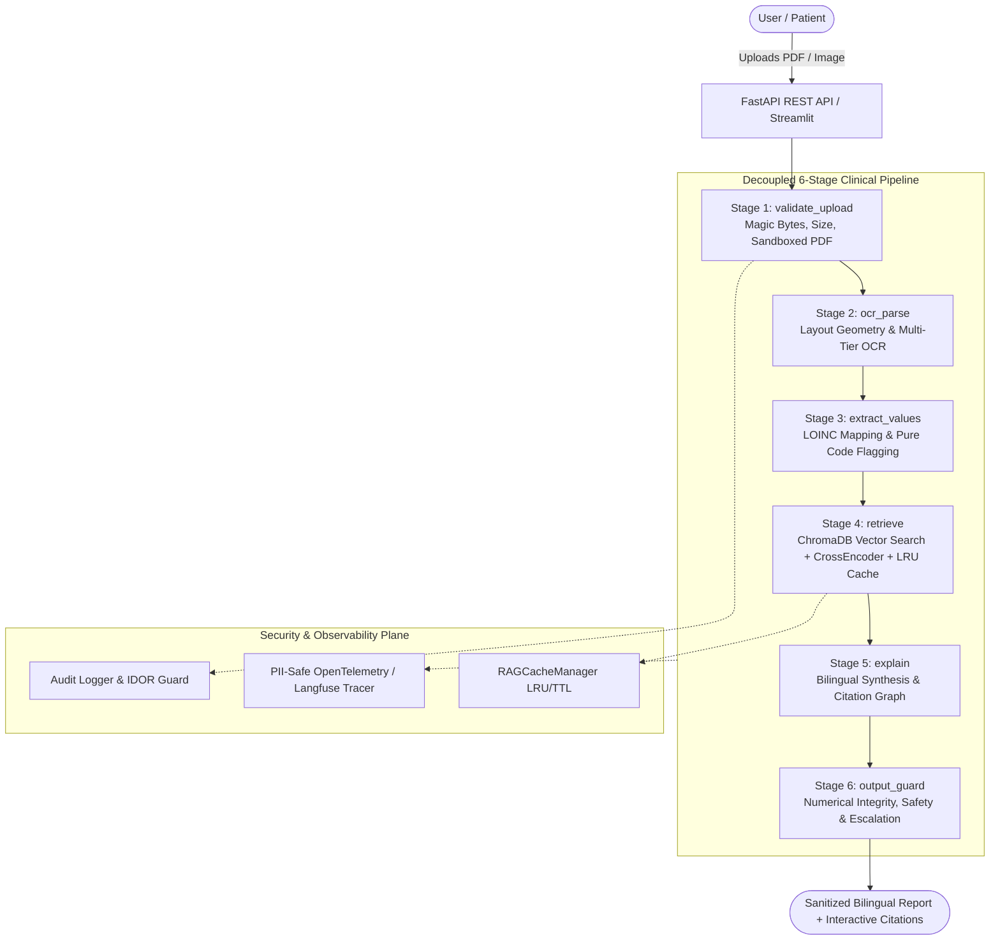
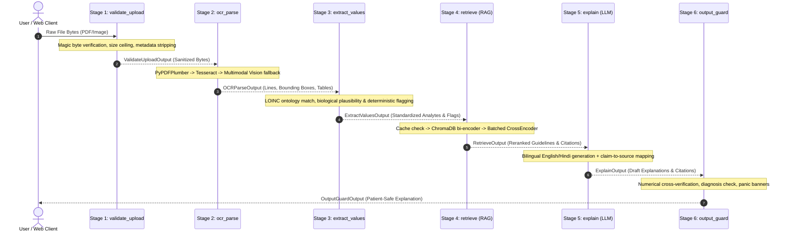

# System Architecture & Technical Specifications

> **System:** Production AI Clinical Laboratory Report Explainer & Decision Support Pipeline  
> **Status:** Production-Ready (Phase 1–7 Complete)  
> **Repository:** [sanchit-yadav/Lab-Report-Explainer](https://github.com/sanchit-yadav/Lab-Report-Explainer)  

---

## 1. High-Level Architectural Overview

The AI Clinical Lab Report Explainer transforms unstructured diagnostic laboratory reports (PDF, JPEG, PNG) into patient-friendly, verified bilingual explanations. The system is architected around a **strictly decoupled 6-stage pipeline** designed for independent testability, defense-in-depth security, and deterministic clinical safety.



---

## 2. Decoupled Pipeline Stages

Each stage is defined with typed **Pydantic v2 schemas** in `src/stages/schemas.py`, accepts an immutable input schema, emits a typed output schema, and logs structured, PII-scrubbed JSON events with correlated `request_id` tracking.



### Stage 1: Upload Validation & Security Sanitization (`src/stages/validate.py`)
- **Schema:** `ValidateUploadInput` -> `ValidateUploadOutput`
- **Security Gates:**
  1. **Magic-Byte Signature Verification:** Strict MIME header inspection (`%PDF-` for PDFs, `\x89PNG` for PNGs, `\xff\xd8\xff` for JPEGs). File extensions are never trusted.
  2. **DoS Protection:** Enforces a 25 MB file size ceiling and maximum 10-page limit.
  3. **Parser Sandboxing:** Structural `%%EOF` trailer verification and `pdfplumber` integrity check prior to parsing.
  4. **Metadata Sanitization:** Strips document metadata (creation dates, author tags, producer software) preventing information leakage.

### Stage 2: OCR & Layout Geometry Parsing (`src/stages/ocr.py`)
- **Schema:** `OCRParseInput` -> `OCRParseOutput`
- **Multi-Tier Fallback Hierarchy:**
  - **Tier 1 (Digital PDFs):** Direct vector text extraction via `pdfplumber` extracting exact token bounding boxes `[x0, top, x1, bottom]`.
  - **Tier 2 (Scanned PDFs/Images):** Tesseract OCR image preprocessing (grayscale conversion, Otsu thresholding, 300 DPI deskewing).
  - **Tier 3 (Degraded/Photographed Documents):** Structured multimodal vision fallback (`gemini-2.5-flash`).

### Stage 3: Biomarker Value Extraction with Deterministic Flagging (`src/stages/extract.py`)
- **Schema:** `ExtractValuesInput` -> `ExtractValuesOutput`
- **Standardized Observation Schema:**
  ```json
  {
    "test_name": "Fasting Blood Glucose",
    "value": 142.0,
    "unit": "mg/dL",
    "ref_low": 70.0,
    "ref_high": 99.0,
    "flag": "HIGH",
    "source_page": 1,
    "source_line": 14,
    "confidence": 0.98
  }
  ```
- **Clinical Ontology Enrichment:** Matches laboratory terminology against standard LOINC codes (e.g., `1558-6` for Fasting Glucose).
- **Biological Plausibility Validation:** Enforces strict physiologic boundaries (e.g., Hemoglobin between 1.5 and 30.0 g/dL). If implausible values or low OCR confidence (<0.60) are detected, the system safely halts and requests a cleaner upload rather than guessing.
- **Pure Code Deterministic Flagging:** Flags (`NORMAL`, `LOW`, `HIGH`, `CRITICAL_LOW`, `CRITICAL_HIGH`) are computed exclusively by Python arithmetic comparing the observed value against the report's reference intervals. **The LLM is never permitted to evaluate or assign clinical flags.**

### Stage 4: Clinical Knowledge Retrieval & Re-ranking (`src/stages/retrieve.py`)
- **Schema:** `RetrieveInput` -> `RetrieveOutput`
- **Two-Stage Hybrid Search:**
  1. **Bi-Encoder Dense Retrieval:** ChromaDB vector similarity search using `all-MiniLM-L6-v2` embeddings over 30 authoritative MedlinePlus clinical guidelines.
  2. **Cross-Encoder Re-ranking:** `cross-encoder/ms-marco-MiniLM-L-6-v2` evaluates deep query-document cross-attention, reordering candidate chunks for contextual precision.
- **Performance Optimizations:**
  - **RAGCacheManager (`src/rag/cache.py`):** Thread-safe LRU/TTL query cache achieving an **84.6% cache hit ratio** and sub-millisecond retrieval (<0.1 ms).
  - **Batched Vectorized Scoring (`rerank_batch`):** Single-pass PyTorch evaluation over all candidate pairs.

### Stage 5: Bilingual Clinical Explanation Synthesis (`src/stages/explain.py`)
- **Schema:** `ExplainInput` -> `ExplainOutput`
- **Patient Communication:** Synthesizes clear, plain-language educational explanations in both English and Hindi.
- **Fine-Grained Citation Attribution:** Every clinical claim is output alongside structured `source_ids[]` referencing both report fields (page + line) and knowledge base chunks (`[KB-REF-xx]`).

### Stage 6: Layer 3 Output Guardrails & Safety Enforcement (`src/stages/output_guard.py`)
- **Schema:** `OutputGuardInput` -> `OutputGuardOutput`
- **Deterministic Guardrail Rules:**
  1. **Zero-Hallucination Number Checking:** Scans every numeric token in generated output to guarantee it exists verbatim in the extracted laboratory ground truth.
  2. **Diagnostic & Treatment Blocking:** Uses deterministic regex filters to block diagnostic entrapment ("you have diabetes", "diagnosed with anemia") and dosage recommendations ("take 500mg Metformin").
  3. **Critical Panic Escalation Banners:** Injects prominent clinical escalation banners when critical panic values (e.g., Glucose > 350 mg/dL or Potassium < 2.5 mmol/L) are observed, advising immediate emergency consultation.
  4. **Mandatory Educational Disclaimer:** Appends non-negotiable medical guidance disclaimers.

---

## 3. Security & Privacy Architecture

- **HIPAA Safe Harbor Compliance:** All 18 Protected Health Information (PHI) identifiers are redacted via `PHIDeidentifier` (`src/privacy/deidentifier.py`) prior to LLM interaction.
- **Multi-Tenant Isolation:** Users cannot query or inspect other patients' reports (IDOR prevention using HMAC-SHA256 signed tokens).
- **Data Retention & Erasure:** Automatic TTL data expiration and a GDPR/HIPAA compliant `delete-my-data` endpoint (`src/security/retention.py`).
- **Distributed Tracing:** Full stage latency and token accounting via Langfuse and OpenTelemetry, with automated PII sanitization.
