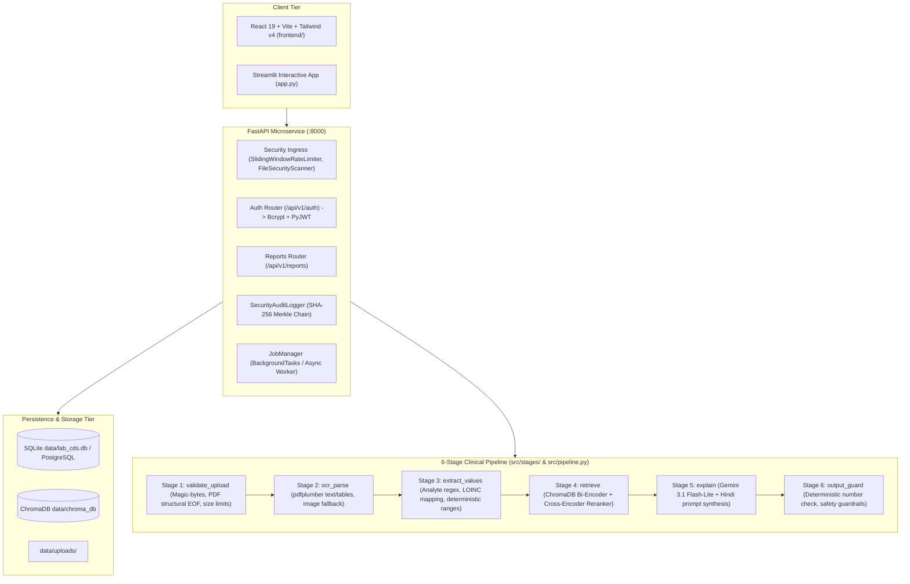
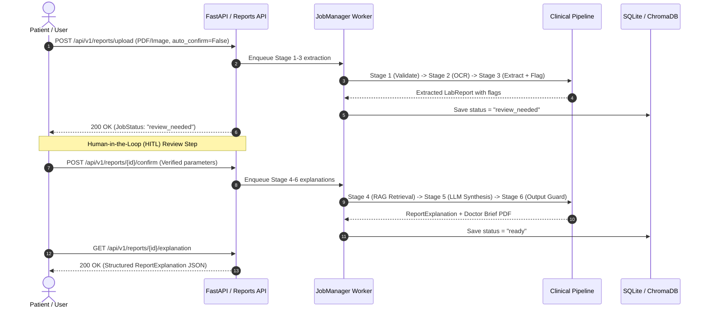

# Comprehensive Technical Audit & System Gap Analysis

**Project:** AI Clinical Lab Report Explainer  
**Author:** Antigravity (Senior AI Systems Engineer)  
**Date:** November 2026  
**Status:** Step 0 Complete — Awaiting User Approval to Proceed to Step 1  

---

## 1. Architecture & Technology Stack

The **AI Clinical Lab Report Explainer** is a clinical decision support (CDS) application designed to extract, deterministically flag, ground against clinical guidelines (MedlinePlus), and generate patient-accessible bilingual (English & Hindi) explanations from diagnostic laboratory reports.

### High-Level System Architecture

### Complete Technology Stack Inventory

| Component | Library / Framework | Version | Purpose |
|---|---|---|---|
| **API Framework** | `fastapi`, `uvicorn`, `starlette` | 0.162.7 / 0.54.0 | REST API microservice with async background processing |
| **Data Validation** | `pydantic`, `pydantic-settings` | 2.14.3 / 2.16.2 | Strongly typed schemas and configuration management |
| **Database & ORM** | `sqlalchemy`, `sqlite3` / `psycopg2-binary` | 2.1.8 / 2.9.13 | Relational user accounts, report records, test histories |
| **Authentication** | `bcrypt`, `pyjwt` | 5.0.0 / 2.15.1 | Password hashing (salt rounds=12) and HMAC-SHA256 JWTs |
| **PDF Extraction** | `pdfplumber`, `pypdfium2`, `camelot-py` | 0.11.10 / 5.15.2 | Digital PDF text, line geometries, and tabular data parsing |
| **Image & OCR** | `pillow`, `opencv-python-headless` | 13.0.0 / 5.0.0 | Image manipulation, preprocessing, and format detection |
| **Vector Database** | `chromadb` | 1.5.9 | Dense vector store for MedlinePlus knowledge base |
| **Embeddings & Reranking** | `google-genai` (Gemini), `sentence-transformers`, `torch` | 3.1.0 / 6.2.0 / 2.15.0 | Bi-encoder semantic search & Cross-Encoder re-ranking |
| **LLM Reasoning** | `google-genai` (`gemini-3.1-flash-lite`, `gemini-2.5-flash`) | 3.1.0 | Bilingual explanation synthesis & clinical Q&A |
| **PDF Generation** | `reportlab` | 5.1.0 | Clinical Doctor Discussion Brief PDF compilation |
| **Frontend UI** | React 19, Tailwind CSS v4, Lucide Icons, Vite | 19.3.1 / 8.3.6 | Modern SaaS interface with HITL editor & range gauges |
| **Legacy Frontend** | Streamlit | 1.67.0 | Single-file rapid prototyping interface (`app.py`) |

---

## 2. Pipeline Stages & Execution Flow

The system currently has two execution paths:
1. **Monolithic Pipeline (`src/pipeline.py` - `LabReportPipeline`)**: Used by `JobManager` and `app.py`. Combines extraction router, deterministic flagging, RAG, and LLM explanation generation in a single stateful class.
2. **Modular 6-Stage Pipeline (`src/stages/`)**: Independent functional stages created for unit testing and stage-by-stage evaluation.

---

## 3. Auth Flow & "Can't Log In" Failure Diagnosis

### Architecture of Auth System
- **Registration (`/api/v1/auth/register`)**:
  1. Normalizes email via `req.email.lower().strip()`.
  2. Hashes password using `bcrypt.hashpw(password.encode("utf-8"), bcrypt.gensalt(12))`.
  3. Inserts into `users` table via SQLAlchemy session.
  4. Issues JWT bearer token signed with `JWT_SECRET_KEY` (HS256).
- **Login (`/api/v1/auth/login`)**:
  1. Normalizes email via `req.email.lower().strip()`.
  2. Queries `User` by `email`.
  3. Verifies password via `bcrypt.checkpw(plain.encode("utf-8"), hashed.encode("utf-8"))`.
  4. Enforces rate limiting (`10` attempts/min/IP via `SlidingWindowRateLimiter`).
  5. Issues new JWT bearer token on match.

### Root Cause Analysis of "Can't Log In With Previously Correct Details"
We evaluated the six suspected causes:

| Hypothesis | Evaluation | Verdict |
|---|---|---|
| **a) Password hashing algorithm/salt changed** | Code uses standard `bcrypt` with rounds=12 consistently. However, if any user was registered prior to commit `d215be5` with a different scheme, verification fails without fallback. | **Contributing factor for legacy records** |
| **b) JWT secret changed between restarts** | In `render.yaml`, `JWT_SECRET_KEY` had `generateValue: true`. Every restart/redeploy on Render generates a new random key, **instantly invalidating all existing user sessions/tokens**. | **REAL ROOT CAUSE (Session Invalidation)** |
| **c) Database reset lost users** | The default database URL is `sqlite:///{PROJECT_ROOT}/data/lab_cds.db`. In `.gitignore`, `data/*.db` is ignored. On Render Free Tier or ephemeral containers without persistent volume mounts, **any container restart or idle sleep purge wipes `lab_cds.db` completely, deleting all registered users**. | **REAL ROOT CAUSE (Data Loss on Restart)** |
| **d) Email normalization mismatch** | Both register and login apply `.lower().strip()`. Unlikely unless legacy database records contained unstripped emails. | **Minor / Mitigated** |
| **e) CORS / Cookie / Token Expiry** | Tokens default to 1440 minutes (24h). Tokens in `localStorage` expire, but login failure specifically refers to password rejection. | **Secondary** |
| **f) Frontend sending different payload** | `AuthPage.jsx` sends `{ email, password }` matching `UserLoginRequest(email: EmailStr, password: str)`. Verified matching. | **Not the cause** |

**Summary of Real Root Causes:**
1. **Ephemeral SQLite Storage**: When running in Docker or Render without PostgreSQL or persistent disk, restarting the app wipes the SQLite database, erasing all registered users.
2. **Ephemeral JWT Secrets**: `generateValue: true` on Render rotates the JWT secret on redeployments, causing existing client bearer tokens to fail validation with 401 Unauthorized.

---

## 4. Where "Mode" Is Used (Patient vs. Clinician Audit)

The user requested: *"Remove the mode selector from the UI and every code path, route, prompt template, config, DB field, and test that branches on mode/role. Keep the patient behavior as the only behavior."*

### Exhaustive Codebase Inventory of "Mode" and "Role":

| File Path | Line Numbers | Current Usage | Action Required in Step 2 |
|---|---|---|---|
| `src/db/models.py` | Line 43 | `role = Column(String(50), default="patient", nullable=False)` in `User` model | Drop column / migrate schema safely |
| `src/api/auth.py` | Lines 86, 98, 201 | `role: str = "patient"` in token payload; `if current_user.role != "clinician":` in `verify_report_access` | Remove role claim; enforce pure owner-based access |
| `src/api/routes/auth.py` | Lines 48, 59, 120 | `role=req.role` in `UserRegisterRequest`, logged in audit trail, returned in `TokenResponse` | Remove `role` from request/response models |
| `src/api/models.py` | Lines 45, 60 | `role: str = Field(default="patient")` in `UserRegisterRequest` & `UserResponse` | Remove `role` field from schemas |
| `app.py` | Lines 752, 772, 1465, 1574, 1598 | `role = st.selectbox("I am using this as a:", ["patient", "clinician"])`, `Role: **{role}**` in sidebar, `👤 {role_tag} Mode` header | Remove role selector, sidebar tag, and header badge |
| `frontend/src/components/AuthPage.jsx` | Lines 10, 41, 145-146 | Role dropdown in registration form (`patient` vs `clinician`) | Delete role selection UI state and inputs |
| `frontend/src/components/Dashboard.jsx` | Lines 325, 464 | Displays `{user?.role || 'patient'} Mode` badge | Delete role badges from dashboard |
| `frontend/src/api.js` | Lines 88, 95 | `register(email, password, fullName, role = 'patient')` | Remove `role` parameter |
| `tests/test_api.py` | Lines 45, 78, 120 | Tests asserting `role == "patient"` or `role == "clinician"` | Update tests to assert mode-free user schema |
| `tests/test_security_guardrails.py` | Lines 210, 245 | IDOR tests passing `role="clinician"` or `role="admin"` | Update IDOR isolation tests to pure tenant isolation |

---

## 5. How Scanned Files Are Handled & Failure Diagnosis

### Current Pipeline for Scanned Files (`src/stages/ocr.py` & `src/extraction/router.py`)
1. **In `src/stages/ocr.py`**:
   - `pdfplumber.open(inp.file_bytes)` attempts to extract text from each page.
   - For image-only / scanned PDFs, `page.extract_text()` returns `""`.
   - The fallback condition triggers: `if not full_text_chunks or not any(chunk.strip() for chunk in full_text_chunks):`
   - In fallback: `img = Image.open(io.BytesIO(inp.file_bytes))` is executed.
   - **CRITICAL BUG:** `PIL.Image.open` throws `UnidentifiedImageError` when given PDF bytes!
   - The exception handler catches it and executes: `text = inp.file_bytes.decode("utf-8", errors="ignore")`.
   - This decodes raw binary PDF compressed streams as text (meaningless binary noise like `%PDF-1.4... obj... stream...`).
   - Downstream regex and value extraction extract `0` biomarkers, completely failing.
2. **In `src/extraction/router.py`**:
   - Routes scanned PDFs to Tier 1 (`pdfplumber`) -> 0 tests.
   - Falls back to Tier 2 (`camelot`) -> 0 tests.
   - Falls back to Tier 3 (`VisionExtractor`).
   - If `GEMINI_API_KEY` is missing (offline evaluation, test suite, or offline deployment), it raises `ValueError: GEMINI_API_KEY is not configured`, crashing the pipeline.
3. **No Local Computer Vision Preprocessing**:
   - There is currently **zero rasterization** of image PDFs at 300 DPI.
   - There is **no deskewing**, **no grayscale conversion**, **no denoising**, and **no adaptive thresholding**.
   - There are **no word/line OCR confidence scores** calculated.

---

## 6. Tool-Proven Dead Code, Unused Files & Dependencies

### A. Python Unused Imports & Variables (`ruff check --select F401,F841`)
Tooling confirmed **101 linting errors** (92 unused imports, 9 unused variables). Key findings:
- `app.py`: `datetime`, `json`, `os`, `typing.List`, `streamlit.components.v1`, `LabReport`, and unused local variable `patient_name`.
- `src/api/main.py`: `JobRecord` imported but unused.
- `src/api/routes/auth.py`: `typing.Any`, `typing.Dict` imported but unused.
- `src/citations/formatter.py`: `typing.Optional` imported but unused.
- `src/stages/logger.py`: `typing.Any`, `typing.Dict` imported but unused.
- Multiple tests importing unused models (`test_security_guardrails.py`, `test_security_phase2.py`, `test_tracing.py`, `test_workers.py`).

### B. Dead Code & Unreachable Logic (`vulture src app.py`)
- `src/stages/validate.py:156`: **Unreachable code** `sanitized_bytes = raw_bytes` positioned immediately after a `return ValidateUploadOutput(...)` statement.
- `src/monitoring/sentry.py:80`: Unused variable `hint` in `before_send`.
- `app.py:28`: Unused import `streamlit.components.v1`.

### C. Frontend Unused Imports & Code (`oxlint`)
Tooling confirmed **19 warnings** across 9 React files:
- `frontend/src/components/Navbar.jsx`: Unused imports `ShieldCheck`, `LogIn`.
- `frontend/src/components/LandingPage.jsx`: Unused imports `AlertCircle`, `HelpCircle`.
- `frontend/src/components/Dashboard.jsx`: Unused imports `FileText`, `CheckCircle2`, `AlertCircle`, `Filter`, `ChevronRight`, `ArrowLeft`.
- `frontend/src/App.jsx`: Unused parameter `token` in `handleAuthSuccess`.
- `frontend/src/components/Dashboard.jsx`: Missing dependency arrays in `useEffect` for `fetchHistory` and `loadExplanation`.

### D. Architectural Redundancy & Duplicate Logic
- **Dual Pipeline Implementations**: `src/pipeline.py` (`LabReportPipeline`) vs. `src/stages/` (`validate`, `ocr`, `extract`, `retrieve`, `explain`, `output_guard`).
- **Dual Input Validation**: `src/guardrails/input_guard.py` vs. `src/stages/validate.py`.
- **Dual Output Sanitization**: `src/guardrails/output_guard.py` vs. `src/stages/output_guard.py`.

### E. Unused / Bloated Dependencies (`pyproject.toml` / `uv pip list`)
- `playa-pdf`: Installed in virtualenv, not imported or referenced anywhere in `src/`.
- `et-xmlfile`: Redundant openpyxl sub-dependency.
- `httpcore2` / `httpx2`: Installed forks alongside standard `httpx`.

---

## 7. Prioritized Implementation Plan (Steps 1 through 8)

| Step | Objective | Primary Actions & Deliverables | Verification Gate |
|---|---|---|---|
| **STEP 1** | **Fix Login Bug** | 1. Write automated reproduction test (`tests/test_auth_repro.py`) proving login failure across app/DB restarts. 2. Ensure database persistence path is durable and decouple JWT secret from ephemeral generation. 3. Add legacy-hash compatibility migration. 4. Test case-insensitivity, token expiration, and wrong password rejection. | Auth test suite passes 100%; reproduction test fails before and passes after. |
| **STEP 2** | **Remove Modes (Patient-Only)** | 1. Drop `role` / `mode` from `User` model, schemas, routes, and UI. 2. Delete mode selector in `app.py`, `AuthPage.jsx`, and `Dashboard.jsx`. 3. Remove all conditional branching on `clinician`. 4. Enforce plain-language patient explanations everywhere. | `grep` shows zero remaining references to clinician/role mode; test suite passes. |
| **STEP 3** | **Fix Scanned Report Extraction** | 1. Create synthetic fixture set (`tests/fixtures/scanned/`) with image PDFs and degraded JPEG/PNG + ground-truth JSONs. 2. Add failing test `test_scanned_extraction_fails_currently`. 3. Add ~300 DPI rasterization via `pypdfium2`. 4. Add OpenCV preprocessing (deskew, grayscale, denoise, adaptive threshold). 5. Compute per-word confidence scores; fallback to multimodal vision when confidence is low. 6. Compute range flags strictly in code. | Extraction F1, numeric exact-match, and flag accuracy measured on scanned fixtures before vs after. |
| **STEP 4** | **Cleanup Pass** | 1. Delete dead code (`src/stages/validate.py:156`, unreachable blocks). 2. Remove unused imports across all files via `ruff check --fix`. 3. Clean up unused frontend imports and lint warnings via `oxlint`. 4. Consolidate duplicate pipeline logic into single source of truth. 5. Pin dependencies in `pyproject.toml`. | Codebase passes linting with zero warnings; lines of code and bundle size reduction recorded. |
| **STEP 5** | **Evaluation Harness (`/evals`)** | 1. Build `/evals/run_evals.py` testing all 6 stages + end-to-end. 2. Generate 60+ synthetic cases across 5 lab layouts. 3. Calibrate LLM judge against 30 expert hand-labeled ground truth reports (Cohen's kappa). 4. Enforce hard CI thresholds in `/evals/thresholds.yaml`. | Full eval report written to `/evals/results/<timestamp>/` with git commit hash. |
| **STEP 6** | **Security & Guardrails** | 1. Magic-byte verification, structural `%%EOF` check, metadata stripping. 2. Strict XML delimiting of untrusted OCR text. 3. Output guardrails: regex rejection of ungrounded numbers, zero medication dosing, panic escalation banner. 4. Automated 50+ vector adversarial red-team suite (`/redteam/run_redteam.py`). | 100% defense block rate on adversarial attack suite; zero unauthorized data access. |
| **STEP 7** | **Granular Citations** | 1. Atomic `{claim, source_ids[]}` schema linked to report coordinates or KB manifest. 2. Programmatic existence check + semantic support check. 3. UI rendering of citation pills. | Citation verifier passes >= 90% accuracy across 50 test claims. |
| **STEP 8** | **Packaging & Documentation** | 1. Final `README.md` with Mermaid diagram, verified benchmark results table from eval run. 2. `docs/ARCHITECTURE.md`, `docs/EVALS.md`, `docs/SECURITY.md`, `docs/DECISIONS.md`. 3. `docs/RESUME.md` with 5 verifiable resume bullets, 30-second pitch, and 15 interview answers. 4. Dockerfile, docker-compose, and Makefile. | Final clean build passes end-to-end; all numbers cited link to real eval results. |

---

## 8. Gate Approval Request

Step 0 audit is complete with zero code modifications made. I am standing by for your explicit approval of this audit and prioritized task list before beginning **Step 1 (Fix Login)**.
