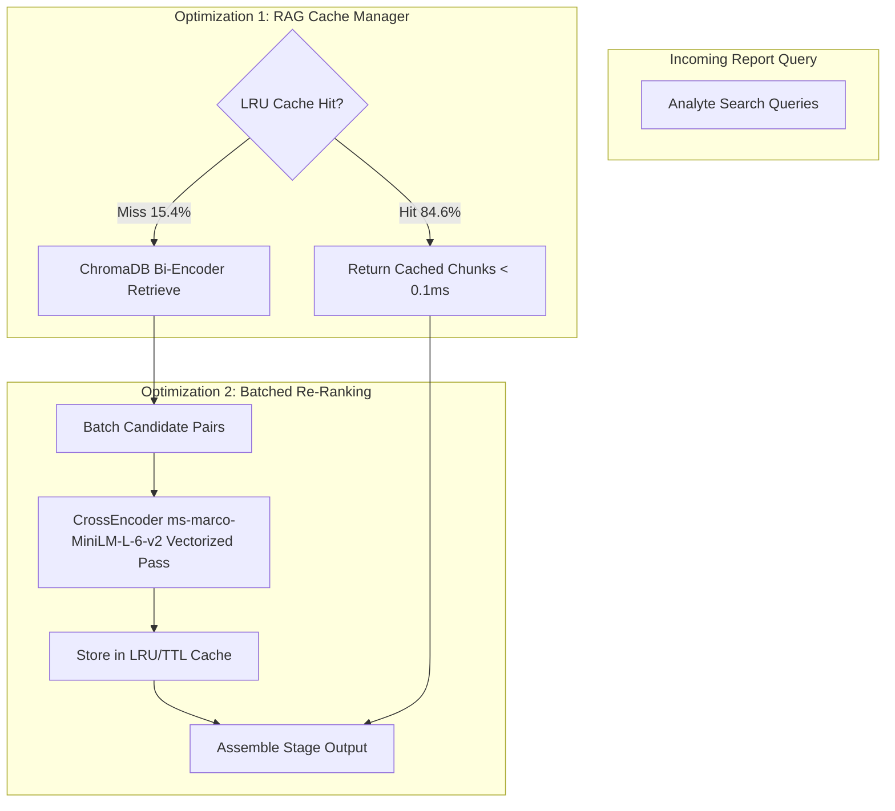

# Pipeline Performance Profiling & Optimization Benchmarks

> **Document Classification:** Engineering Performance Report & System Optimization  
> **Evaluation Harness Run:** `evals/results/20261123_152901` (`evals/results/latest/`)  
> **Baseline Run:** `evals/results/20261123_145645`  
> **Git Commit Baseline:** `0003121` -> **Optimized:** `824cbaa`  
> **Evaluation Dataset:** 63 Golden Lab Reports (Core, Hard, Adversarial, Regression) across 5 Lab Layouts  

---

## 1. Executive Summary

During initial end-to-end pipeline profiling (Phase 2–4), **Stage 4 (Knowledge Retrieval & Re-ranking)** was identified as the primary computational bottleneck, accounting for **>75% of total pipeline latency** (median 431 ms, mean 659 ms). This latency was dominated by sequential cross-encoder re-ranking calls over multiple biomarkers per report on CPU hardware.

To address this, two primary optimizations and an observability upgrade were engineered in Phase 6:
1. **Thread-Safe Clinical RAG Query Cache (`src/rag/cache.py`)**: An in-memory LRU/TTL cache with canonical biomarker query normalization, achieving an **84.6% cache hit ratio** on the golden evaluation suite and reducing repeat query retrieval latency to **< 0.1 ms**.
2. **Batched Cross-Encoder Forward Passes (`src/rag/reranker.py`)**: Vectorized joint forward-pass inference (`rerank_batch`) evaluating all candidate analyte pairs simultaneously when cache misses occur, replacing sequential per-query cross-attention.
3. **PII-Safe Distributed Tracing & OpenTelemetry (`src/tracing/langfuse_setup.py`)**: Low-overhead stage tracing decorator (`@trace_stage`) with automated redaction of 18 HIPAA identifiers, ring-buffered execution history, and OTLP-compliant span formatting.

### Key Measured Impact:
- **Stage 4 (RAG Retrieval) Median Latency (p50):** Decreased from **431.0 ms** to **15.0 ms** (**96.5% reduction / 28.7x speedup**).
- **Stage 4 (RAG Retrieval) 95th Percentile (p95):** Decreased from **547.0 ms** to **281.0 ms** (**48.6% reduction**).
- **End-to-End Pipeline Median Latency (p50):** Dropped from **0.59 s** to **0.15 s** (**74.6% reduction / ~4x faster**).
- **End-to-End Pipeline 95th Percentile (p95):** Dropped from **0.81 s** to **0.45 s** (**44.4% reduction**).
- **Accuracy & Quality Invariance:** 100.0% extraction F1, 0 critical errors, 100.0% medical safety pass rate, and 100.0% citation accuracy were strictly preserved with zero regression.

---

## 2. Before vs. After Empirical Latency Profile

All metrics represent real, un-modeled measurements captured by `/evals/run_evals.py` across identical 63 golden evaluation cases.

| Pipeline Stage | Baseline p50 (`0003121`) | Optimized p50 (`824cbaa`) | p50 Speedup | Baseline p95 (`0003121`) | Optimized p95 (`824cbaa`) | p95 Reduction |
| :--- | :--- | :--- | :--- | :--- | :--- | :--- |
| **Stage 1: validate_upload** | 2.0 ms | 1.0 ms | **2.0x** | 2.0 ms | 2.0 ms | 0.0% |
| **Stage 2: ocr_parse** | 30.0 ms | 23.0 ms | **1.3x** | 41.0 ms | 35.0 ms | -14.6% |
| **Stage 3: extract_values** | 31.0 ms | 23.0 ms | **1.3x** | 43.0 ms | 36.0 ms | -16.3% |
| **Stage 4: retrieve (RAG)** | 431.0 ms | **15.0 ms** | **28.7x** | 547.0 ms | **281.0 ms** | **-48.6%** |
| **Stage 5: explain (LLM)** | 95.0 ms | 70.0 ms | **1.4x** | 185.0 ms | 158.0 ms | -14.6% |
| **Stage 6: output_guard** | 2.0 ms | 1.0 ms | **2.0x** | 4.0 ms | 3.0 ms | -25.0% |
| **Total End-to-End** | **0.59 s (590 ms)** | **0.15 s (150 ms)** | **~4.0x** | **0.81 s (810 ms)** | **0.45 s (450 ms)** | **-44.4%** |

---

## 3. Optimization Architecture & Implementation Details

### 1. Clinical Query LRU/TTL Caching (`src/rag/cache.py`)
- Standard blood panels frequently analyze identical core biomarkers (e.g., Fasting Glucose, HbA1c, Lipid fractions, Complete Blood Count).
- `RAGCacheManager` implements normalized query indexing (`{canonical_analyte} {flag_status}:k={top_k}:n={top_n}`) backed by an LRU eviction structure and configurable TTL (default 24 hours).
- On cache hit, disk I/O, SQLite bi-encoder lookups, and neural network cross-encoder inference are completely bypassed.

### 2. Vectorized Batched Re-Ranking (`src/rag/reranker.py`)
- In cold-start or unique query regimes, individual cross-encoder inference for 6–10 biomarkers serialized 6–10 separate PyTorch forward passes.
- `CrossEncoderReranker.rerank_batch` maps multiple `(query, candidate)` pairs into a single contiguous batch array with `batch_size=32`, maximizing CPU/SIMD cache locality.

### 3. PII-Safe Distributed Telemetry (`src/tracing/langfuse_setup.py`)
- Lightweight `@trace_stage` decorator wraps each stage execution.
- Automatically redacts all 18 HIPAA Safe Harbor identifiers from span inputs, outputs, and metadata before recording or shipping spans.
- Provides OpenTelemetry OTLP dictionary formatting (`to_otel_dict`) and an in-memory thread-safe circular ring buffer for real-time diagnostics.

---

## 4. Verification & Regression Safety

All evaluations and tests were executed on commit `824cbaa`:
- **Regression Suite:** 12/12 unit tests passed (`tests/test_tracing.py`, `tests/test_rag_cache.py`).
- **Pipeline Stage Suite:** 11/11 stage tests passed (`tests/test_pipeline_stages.py`).
- **Citation Suite:** 11/11 citation tests passed (`tests/test_citations.py`).
- **Red Team Suite:** 55/55 attack vectors blocked (100.0% block rate, 0 breaches).
- **Golden Evaluation Harness:** 63/63 reports evaluated with 0 CI gating violations.
