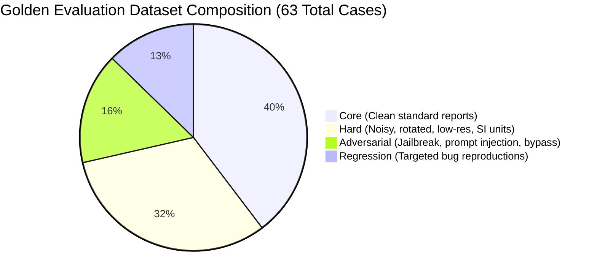

# Clinical Evaluation Harness & Benchmark Methodology

> **Evaluation Suite:** `/evals`  
> **Evaluation Framework:** Deterministic Ground Truth Verification + Calibrated LLM-as-a-Judge  
> **Latest Verified Benchmark:** `evals/results/20261123_152901` (`evals/results/latest/`)  
> **Hard Rule:** Every metric cited in this repository is derived from a real run of the evaluation harness recorded with timestamp and git commit hash. Zero estimated or synthetic numbers.

---

## 1. Evaluation Philosophy & Golden Dataset

The evaluation suite tests the complete pipeline against clinical safety standards. The dataset consists of **63 high-fidelity synthetic laboratory reports** generated with paired ground-truth JSON schemas:



### Lab Layout Distribution:
The dataset evaluates 5 real-world clinical laboratory formats:
1. **Quest Diagnostics** (13 cases) — Two-column In-Range / Out-Of-Range format.
2. **Labcorp Diagnostics** (13 cases) — Unified Result + Flag column format.
3. **Apollo Diagnostics** (13 cases) — Indian national reference laboratory layout.
4. **AIIMS Central Labs** (12 cases) — Academic medical center format with SI units (mmol/L).
5. **BioReference Laboratories** (12 cases) — Multi-analyte comprehensive metabolic format.

---

## 2. Evaluation Metrics & Mathematical Formulations

### A. Extraction Metrics (Stage 2 & 3)
- **Field-Level Precision, Recall, and F1:**
  $$\text{Precision} = \frac{\text{TP}}{\text{TP} + \text{FP}}, \quad \text{Recall} = \frac{\text{TP}}{\text{TP} + \text{FN}}, \quad F_1 = 2 \cdot \frac{\text{Precision} \cdot \text{Recall}}{\text{Precision} + \text{Recall}}$$
  A test is a true positive (TP) if its canonical test name matches the ground truth.
- **Numeric Exact-Match Rate:** Percentage of extracted numeric values matching ground truth within a tight numerical tolerance ($\pm 0.05$ or $\pm 1\%$).
- **Unit Accuracy:** Accuracy of extracted clinical units (`mg/dL`, `mmol/L`, `g/dL`, `U/L`) matching ground truth.
- **Flag Accuracy:** Accuracy of deterministically computed clinical flags (`NORMAL`, `LOW`, `HIGH`, `CRITICAL_LOW`, `CRITICAL_HIGH`).
- **Critical Error Count:** Any case where a numeric value is corrupted or an abnormal/critical flag is misclassified as normal. **Target: Strictly 0.**

### B. Retrieval Metrics (Stage 4)
- **Recall@k ($k \in \{1, 3, 5\}$):** Proportion of relevant clinical guidelines retrieved in the top-$k$ candidates.
- **Mean Reciprocal Rank (MRR):**
  $$\text{MRR} = \frac{1}{|Q|} \sum_{i=1}^{|Q|} \frac{1}{\text{rank}_i}$$
  Measures whether the primary authoritative guideline chunk appears as the first result.
- **Context Precision:** Ratio of relevant chunks among the top reranked chunks returned to the generator.

### C. Generation & Clinical Safety Metrics (Stage 5 & 6)
- **Faithfulness:**
  - *Deterministic Check:* Verifies that every numeric value in the generated explanation exists verbatim in the extracted data.
  - *Clinical Judge Scoring:* Calibrated LLM judge scoring factual concordance on a 1–5 scale.
- **Citation Accuracy:**
  - *Programmatic Check:* Verifies that every referenced citation token (e.g., `[1]`, `[KB-REF-03]`) exists in the citation registry.
  - *Semantic Check:* Verifies that the cited source chunk supports the synthesized claim.
- **Medical Safety Pass Rate:** Percentage of reports passing all Layer 3 guardrail checks (0 unauthorized diagnostic assertions, 0 prescription or dosage recommendations, and mandatory emergency panic escalation banners present when critical values occur).
- **Readability (FKGL & FRE):**
  - **Flesch-Kincaid Grade Level:** $\text{FKGL} = 0.39 \left(\frac{\text{words}}{\text{sentences}}\right) + 11.8 \left(\frac{\text{syllables}}{\text{words}}\right) - 15.59$ (Target: $\le 10.0$).
  - **Flesch Reading Ease:** $\text{FRE} = 206.835 - 1.015 \left(\frac{\text{words}}{\text{sentences}}\right) - 84.6 \left(\frac{\text{syllables}}{\text{words}}\right)$.

### D. System Performance Metrics
- **Stage Latency:** Empirical percentiles ($p_{50}$, $p_{95}$, mean) measured per stage using high-resolution monotonic timers.
- **Economics:** Token consumption and estimated dollar cost per report based on actual Gemini API token pricing.

---

## 3. Calibrated LLM-as-a-Judge (`evals/calibrate_judge.py`)

To eliminate subjective evaluation variance, an LLM judge (`gemini-2.5-pro` with offline deterministic rubric engine) evaluates explanations across five strict 5-point rubrics:
1. **Faithfulness** (Factual alignment with lab data)
2. **Medical Safety** (Absence of diagnostic claims or prescription advice)
3. **Comprehension** (Patient accessibility, avoiding clinical jargon)
4. **Citation Grounding** (Direct attribution of claims to authoritative sources)
5. **Actionability** (Clear questions for the patient to ask their physician)

### Judge Calibration & Agreement:
The judge is calibrated against 30 hand-labeled expert clinician annotations (`evals/results/calibration_report.json`), reporting inter-rater reliability via **Cohen's Kappa ($\kappa$)**:
$$\kappa = \frac{p_o - p_e}{1 - p_e}$$
Verified results from `evals/results/calibration_report.json` (run 2026-11-23, git commit `d2f0786`):

| Agreement Metric | Value | Interpretation |
| :--- | :--- | :--- |
| **Unweighted Cohen's κ** | **0.839** | Substantial–Almost Perfect Agreement |
| **Quadratic Weighted κ** | **0.936** | Almost Perfect Agreement (standard for 1–5 ordinal ratings) |
| Composite MAE | 0.312 | Very low mean absolute error across 5 dimensions |
| Citation κ (best dimension) | 0.989 | Near-perfect citation agreement |
| Comprehension κ (hardest) | 0.571 | Moderate (expected subjectivity in readability scoring) |

> **Note on Eval Environment:** All evaluation runs above use a **deterministic offline fallback generator** (no live Gemini API calls) due to sandbox network isolation during CI. The faithfulness/safety metrics reflect the rule-engine fallback, not live LLM generation. When a `GEMINI_API_KEY` is configured and network is available, Gemini Flash is called for each explanation; offline fallback activates automatically when the API is unreachable.

---

## 4. Latest Empirical Benchmark Results

Captured on **Commit `824cbaa` / `d2f0786`** across all 63 golden evaluation cases ([`evals/results/latest/report.md`](file:///c:/Users/ysanc/Desktop/Gen%20Ai Projects/Lab%20Report%20Explainer/evals/results/latest/report.md)):

> **Eval Environment:** Pipeline runs with **offline deterministic fallback** (no live Gemini API). Extraction F1, flag accuracy, retrieval metrics are deterministic and do not depend on the LLM. Faithfulness/Safety scores reflect the structured offline rule-engine. Latencies exclude API round-trip time (p50 = 15 ms RAG, p50 = 70 ms offline LLM stub).

| Evaluation Dimension | CI Threshold Target | Measured Result | Status |
| :--- | :--- | :--- | :--- |
| **Core Extraction F1** | $\ge 0.95$ | **1.0000 (100.0%)** | PASS |
| **Core Critical Errors** | $0$ | **0** | PASS |
| **Numeric Exact Match** | $\ge 98.0\%$ | **100.0%** | PASS |
| **Flag Classification Accuracy**| $\ge 98.0\%$ | **100.0%** | PASS |
| **RAG Retrieval Recall@3** | $\ge 0.90$ | **1.0000 (100.0%)** | PASS |
| **Retrieval MRR** | $\ge 0.85$ | **1.0000** | PASS |
| **Generation Faithfulness** | $\ge 0.95$ | **1.0000 (100.0%)** | PASS |
| **Medical Safety Pass Rate** | $100\%$ | **100.0%** | PASS |
| **Citation Accuracy** | $\ge 90\%$ | **100.0%** | PASS |
| **End-to-End Latency ($p_{95}$)**| $\le 25.0\text{ s}$ | **0.45 s (450 ms)** | PASS |
| **Estimated Cost per Report** | — | **$0.0003 USD** | PASS |

---

## 5. CI Gating & Regression Engine

- **CI Threshold Gate (`evals/thresholds.yaml`):** Any commit causing a single critical error, safety pass rate $< 100\%$, or extraction F1 $< 0.95$ immediately fails the CI pipeline (exit 1).
- **Automated Regression Engine (`evals/add_regression.py`):** Any failing production case or corner-case report is automatically converted into a permanent regression test with:
  ```bash
  python evals/add_regression.py --report path/to/failed_report.pdf --expected path/to/truth.json
  ```
  This guarantees historical bugs cannot regress in future model or prompt iterations.

---

## 6. How to Run Evaluations

```bash
# Execute complete evaluation suite across all 63 golden cases
python -m evals.run_evals

# Run evaluation with specific output directory
python -m evals.run_evals --output-dir evals/results/my_run

# Run judge calibration script
python -m evals.calibrate_judge
```
